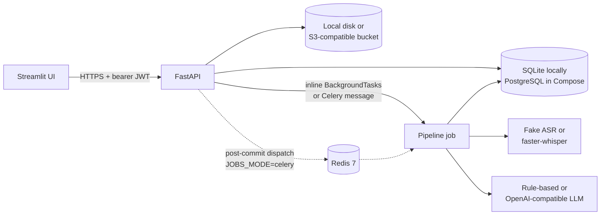

# Meeting Transcription & Action-Item Intelligence Platform

Turn recorded meetings into **traceable** business intelligence: timestamped transcripts, summaries, decisions, and action items that point back to the exact words that justify them.

> **Status: working MVP, verified locally on 2026-11-02.**
> The API, database schema and migrations, Streamlit UI, Docker Compose stack, test suites, and two measured artifacts are implemented. Diarization, scheduled retention, Redis-backed rate limiting, and real-meeting evaluation are explicitly **not** implemented. Nothing below claims a benchmark, deployment, or metric that is not reproducible from a committed artifact.

---

## Why this exists

Meeting recordings are where commitments go to die. Generic transcription produces a wall of text; generic LLM summarisation produces confident prose that is frequently not in the transcript. For a task list, that is worse than useless — an invented owner or deadline becomes someone else's problem.

This project treats **grounding as a first-class constraint**, not a prompt suggestion:

- Every stored decision and action item has `evidence` rows pointing at transcript segments and a verbatim quote.
- The server re-checks each quote against the referenced segment. Items whose evidence cannot be verified are dropped and counted, not silently shown.
- Owners and dates the conversation does not support are stored as `unassigned` / `null` / `unknown`. They are never inferred from plausibility.
- The verbatim deadline phrase is preserved alongside any resolved date, and date precision is explicit (`day`, `week`, `month`, `unknown`).

## What works today

| Capability | Status | What is actually implemented |
|---|---|---|
| Authentication | **Implemented** | Argon2id password hashing, 15-minute JWT access tokens, opaque rotating refresh tokens, refresh-reuse detection that revokes the token family, per-user scoping, `401`/`404` without existence leaks |
| Meetings | **Implemented** | Create, list, detail, patch, delete; upload with size/duration caps, content sniffing and `ffprobe` validation, SHA-256 dedupe, local or S3-compatible object storage |
| Pipeline | **Implemented** | One `pipeline` job with `transcribing` and `analyzing` stages; inline background tasks locally, Celery + Redis in Compose; typed failures and retryable status |
| ASR | **Implemented** | Deterministic fake provider for tests/demos, real `faster-whisper` adapter with VAD, word timestamps, language detection |
| Intelligence | **Implemented** | Deterministic rule-based extractor (offline, no API key) and an OpenAI-compatible adapter with Pydantic-validated structured output |
| Grounding | **Implemented** | Whitespace/case-insensitive quote verification with original offsets, evidence rows, per-run counts of dropped items and grounding failures |
| Exports | **Implemented** | Markdown meeting report, JSON export, action-item CSV |
| Streamlit UI | **Implemented** | Register/login, dashboard, upload with progress polling, meeting list/detail, transcript view, action-item editing, exports; no raw HTML rendering |
| Migrations | **Implemented** | Alembic initial schema against SQLite; `downgrade base` and `upgrade head` both verified |
| Docker Compose | **Defined and config-validated** | PostgreSQL 16, Redis 7, API, Celery worker, Streamlit; images are not built in this environment |
| CI | **Workflow committed, not executed on GitHub** | Ruff, mypy, backend and frontend tests |
| Evaluation | **Implemented for a narrow scope** | Three synthetic text fixtures for the rule-based extractor + one synthetic TTS clip for the real ASR adapter |
| Diarization | **Implemented** | Provider port (`none`, `fake`, `pyannote`), pipeline speaker alignment with temporal word overlap |
| Scheduled retention | **Implemented** | `enforce_audio_retention` enforces `AUDIO_RETENTION_DAYS`, `purged_at` tracking, orphan storage sweep, Celery Beat scheduled |
| Rate limiting | **Implemented** | Redis-backed distributed sliding-window rate limiter with automatic process-local memory fallback |
| Real-meeting evaluation | **Not started** | No AMI/ICSI download, no WER/DER, no LLM-quality benchmark |

## Architecture



The upload request returns `202` with a job; the client polls `GET /meetings/{id}/status`. The model provider is configuration, not code: the retired GPT-4o/4.1 family is rejected by config validation, and `gpt-6-luna` is the documented replacement placeholder to set in your own account.

## Quick start

### Docker Compose (PostgreSQL + Redis + worker + UI)

```bash
cp .env.example .env
# Set JWT_SECRET to a random value of at least 32 characters.
docker compose up --build
```

- API + OpenAPI: <http://localhost:8000/docs>
- Streamlit UI: <http://localhost:8501>

Register the first account in the UI. The Compose defaults use `ASR_PROVIDER=fake` and `LLM_PROVIDER=rule_based`, so the stack runs end-to-end with **no model download and no API key**. Switch to real transcription by setting `ASR_PROVIDER=faster_whisper` (the worker image includes the ASR extra); switch to an LLM by setting `LLM_PROVIDER=openai_compatible` plus `LLM_BASE_URL`, `LLM_API_KEY`, and a current `LLM_MODEL`.

Compose runs Alembic before starting the API. The Compose file is validated with `docker compose config`; the images were not built or run in this environment, so no "one-command deployment works" claim is made.

### Local Python (SQLite, no Docker)

```bash
python -m venv .venv
uv pip install --python .venv/Scripts/python.exe -e "./backend[dev]"
uv pip install --python .venv/Scripts/python.exe -e "./frontend[dev]"
# optional real ASR:
uv pip install --python .venv/Scripts/python.exe -e "./backend[asr]"

cd backend
../.venv/Scripts/python.exe -m alembic upgrade head
../.venv/Scripts/python.exe -m uvicorn app.main:app --reload
```

In a second terminal:

```bash
API_BASE_URL=http://localhost:8000/api/v1 .venv/Scripts/python.exe -m streamlit run frontend/streamlit_app/app.py
```

On macOS/Linux use `.venv/bin/python`; the `Makefile` selects the right path automatically (`make setup`, `make migrate`, `make test`, `make verify`).

Key environment variables:

| Variable | Default | Purpose |
|---|---|---|
| `DATABASE_URL` | `sqlite:///./data/app.db` | SQLite locally; Compose overrides with PostgreSQL |
| `JWT_SECRET` | placeholder | Must be 32+ random characters; startup rejects the placeholder in production |
| `STORAGE_BACKEND` | `local` | `local` or `s3`; S3 requires the `s3` extra and bucket settings |
| `ASR_PROVIDER` | `fake` | `fake` or `faster_whisper` |
| `LLM_PROVIDER` | `rule_based` | `rule_based` or `openai_compatible` |
| `JOBS_MODE` | `inline` | `inline` or `celery` |
| `MAX_UPLOAD_MB` / `MAX_AUDIO_MINUTES` | `200` / `180` | Hard ingest caps |
| `RATE_LIMIT_ENABLED` | `true` | Process-local limiter toggle |

## Verification actually run

| Check | Command | Result |
|---|---|---|
| Backend tests | `cd backend && ../.venv/Scripts/python.exe -m pytest -q` | **39 passed** |
| Frontend tests | `cd frontend && ../.venv/Scripts/python.exe -m pytest -q` | **3 passed** |
| Lint | `ruff check app tests` (backend) and `ruff check streamlit_app tests` (frontend) | **clean** |
| Types | `cd backend && ../.venv/Scripts/python.exe -m mypy app` | **success, 46 source files** |
| Migrations | `alembic downgrade base && alembic upgrade head` | **both succeeded** on `backend/data/app.db` |
| Evaluation | `.venv/Scripts/python.exe eval/scripts/run_pipeline_eval.py` | **report written** (numbers below) |
| ASR smoke | `.venv/Scripts/python.exe eval/scripts/measure_asr_smoke.py` | **report written** (numbers below) |
| Compose config | `docker compose config -q` | **valid** (needs a local `.env`) |

## Measured results

### 1. Rule-based extraction conformance

Three synthetic text fixtures with hand-labelled decisions and action items, run through the real grounding and persistence path. This measures the **deterministic fallback**, not an LLM.

| Metric | Value | Artifact |
|---|---|---|
| Decision precision / recall / F1 | **1.000 / 1.000 / 1.000** | [`eval/reports/pipeline_conformance.json`](eval/reports/pipeline_conformance.json) |
| Action-item precision / recall / F1 | **1.000 / 1.000 / 1.000** | same |
| Owner accuracy | **0.500** | same |
| Evidence grounding rate | **1.000** | same |
| Invented owners | **0** | same |

The $n$ is three fixtures. Perfect precision/recall on three hand-written texts is a regression baseline, not evidence of general extraction quality. Owner accuracy is 0.5 because one action names "Ravi", who is not linked to a diarized speaker; the system stores `owner_resolution = unresolved_mention` rather than guessing. That is the intended refusal behaviour, and the naive metric correctly shows it as a miss.

### 2. Real ASR adapter smoke test

One synthetic Windows SAPI TTS clip, `faster-whisper` `tiny` with `int8`, single CPU. The model was downloaded once; download time is excluded.

| Metric | Value |
|---|---|
| Audio | 9.643 s, one synthetic speaker |
| Processing | 1.251 s |
| Real-time factor | **0.1297** |
| Word error rate | **0.0455** (one substitution: "twentieth" → "20th") |
| Segments | 2 |
| Artifact | [`eval/reports/asr_smoke.json`](eval/reports/asr_smoke.json) |

This is a clean, synthetic, single-speaker clip and the smallest Whisper model. It proves the adapter loads, transcribes, and reports timing; it is **not** a meeting-audio WER benchmark and has no confidence interval.

### Explicitly not measured

- WER/CER/DER on real meeting audio (AMI, ICSI, or self-recorded)
- Diarization DER, because the pyannote adapter is not wired
- LLM extraction precision/recall/cost, because only the rule-based fallback was evaluated
- Load, concurrency, p95 latency, or queue throughput
- S3 storage path against a real bucket
- Retention/purge behaviour, because no retention job exists

## Four design defects, fixed in code and documentation

1. **Delete ordering vs. a purge job that deletes itself.** Deleting a meeting cannot enqueue a `purge` row that cascades away with the meeting. The delete path captures object keys first, removes rows in explicit dependency order (evidence → items → decisions → key points → intelligence → segments → speakers → transcripts → asset → jobs → meeting), commits, then deletes the objects. A failed object delete is logged for an orphan sweep; it never leaves an observable half-deleted meeting. See `backend/app/services/meetings.py` and `backend/app/api/meetings.py`.
2. **Post-commit dispatch race.** A worker must never consume a message before the producing transaction is visible. `dispatch_pipeline()` is called only after `session.commit()`; no enqueue happens inside the transaction. Delivery is at-least-once with idempotent effects, not exactly-once. A crash in the commit→dispatch gap leaves a persisted queued job; the reconciliation sweep that re-drives it is implemented in `backend/app/services/reconciliation.py` and scheduled in Celery Beat.
3. **Speaker remapping across transcript versions.** Speakers are version-scoped, and `action_items.owner_speaker_id` uses `ON DELETE RESTRICT`. Re-transcription of an existing meeting is deliberately not exposed; analysis re-runs reuse the active transcript. Any future re-transcription must remap owners by display name and downgrade unmatched owners to `unresolved_mention` in the activation transaction, rather than letting a cascade silently null or misattribute owners.
4. **Abuse and XSS controls.** Upload size/duration caps, content sniffing, parameterised SQL, per-user scoping, Argon2id, rotating refresh tokens, and a process-local rate limiter are implemented. The UI renders transcript and model text as text and never calls `unsafe_allow_html`; evidence highlighting is offset-based. The limiter's single-process scope is documented rather than presented as distributed protection.

## Known limitations

1. **Distributed rate limiting requires Redis.** The sliding-window rate limiter coordinates across workers when `RATE_LIMIT_BACKEND=redis` (the Compose default) and falls back to process-local memory if Redis is unavailable.
2. **Diarization on real audio requires HF_TOKEN.** The provider port (`none`, `fake`, `pyannote`) and alignment integration are implemented; `pyannote` requires Hugging Face terms acceptance and token configuration.
3. **Audio retention runs as a scheduled worker job.** `AUDIO_RETENTION_DAYS` is enforced by Celery Beat (`pipeline.purge_expired_audio`) and operational endpoints; offline single-process runs without workers do not trigger periodic purges automatically.
4. **SQLite is the local default.** It is fine for tests and a single-user demo; PostgreSQL is the Compose default.
5. **The LLM path is implemented but not quality-evaluated.** The measured numbers cover the deterministic rule-based extractor only.
6. **The S3 adapter is not integration-tested.** Local storage is the verified path.
7. **No cloud deployment is included or claimed.** Compose is a local stack; the CI workflow has not run on GitHub.
8. **Diarization and ASR quality on real meetings are unknown.** The only ASR measurement is one synthetic TTS clip with the `tiny` model.
9. **Prompt injection is bounded, not solved.** Transcript text is data, and evidence verification limits damage to claims that can quote the transcript; it cannot make a compromised model trustworthy.
10. **No audit log.** The original design's `audit_log` table was dropped from the MVP; edits are not independently auditable beyond row timestamps.

## Repository layout

```text
backend/
  app/
    api/          auth, meetings, action items, system routes, presenters
    core/         config, security, errors, logging
    db/           engine, session, 12 SQLAlchemy models
    schemas/      Pydantic request/response contracts
    services/     auth, meetings, ingest, pipeline, intelligence, grounding, exports, storage
    providers/    ASR and LLM ports + fake/real adapters
    pipelines/    speaker alignment
    workers/      Celery app and tasks
    main.py
  alembic/        migration environment + initial revision
  tests/          unit + integration (23 tests)
frontend/
  streamlit_app/  app.py, api_client.py
  tests/          3 tests
eval/
  fixtures/       3 transcript fixtures + one synthetic TTS clip
  scripts/        conformance harness + real-ASR smoke measurement
  reports/        committed JSON artifacts
infra/docker/     API, worker, frontend images
docs/             PRD, architecture, data model, API spec, roadmap, evaluation plan,
                  risk register, implementation status, 9 ADRs
```

## Documentation

| Document | Contents |
|---|---|
| [Implementation status](docs/07-implementation-status.md) | Implemented / partial / deferred matrix with evidence |
| [Security policy](SECURITY.md) | Controls, accepted risks, production checklist |
| [PRD](docs/00-prd.md) | Personas, requirements, scope, success metrics |
| [Architecture](docs/01-architecture.md) | Containers, pipeline, transactions, security, limitations |
| [Data model](docs/02-data-model.md) | Tables, constraints, delete ordering, versioning |
| [API specification](docs/03-api-spec.md) | Auth, errors, pagination, endpoints, export schema |
| [Roadmap](docs/04-roadmap.md) | Original stage plan and exit gates |
| [Evaluation plan](docs/05-evaluation-plan.md) | Corpora, annotation, metrics, anti-fabrication policy |
| [Risk register](docs/06-risk-register.md) | Ranked risks and mitigations |
| [ADRs](docs/adr/) | Nine architecture decisions with consequences |

## License

The code is licensed under the MIT License; see [LICENSE](LICENSE). Model weights and corpora retain their own licenses.

---

**Status:** working MVP · **Last verified:** 2026-11-02 · **No deployment is claimed.**
