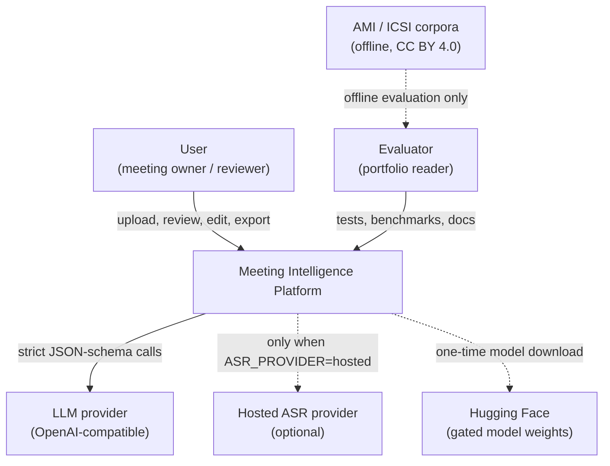
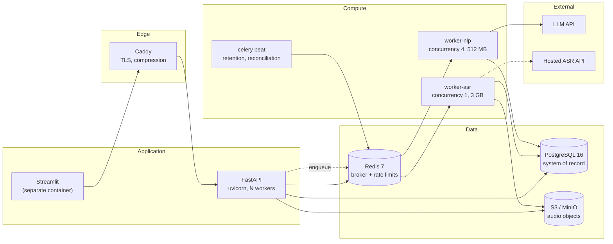

# System Architecture

**Version:** 1.0 (Stage 0)
**Companions:** [Data model](02-data-model.md) · [API spec](03-api-spec.md) · [ADRs](adr/)

---

## 1. Architectural drivers

| Driver | Consequence |
|---|---|
| Transcription is minutes-long and CPU-bound | Work must leave the request/response cycle; jobs must be resumable and observable |
| LLM output is untrusted text | Every response is schema-validated and evidence-verified server-side; the model is never the source of truth |
| Grounding is the product claim | Evidence is relational data with offsets, not a string buried in JSON |
| Providers change and deprecate | ASR, diarization, LLM and storage sit behind ports; model IDs are configuration |
| Must run on a laptop and a $30 VM | No GPU dependency, no Kafka, no Kubernetes, no vector DB |
| Failure is normal | Each pipeline stage has a typed failure, a retry policy, and a visible status |

## 2. System context



The corpus and Hugging Face are **not** runtime dependencies of the product. Only evaluation scripts and the optional diarization extra touch them.

## 3. Container view



**Separation rationale.** ASR and NLP are separate queues because they have incompatible resource profiles: ASR wants one process, several GB of RAM and zero concurrency; LLM work is I/O-bound and benefits from concurrency. Putting them on one worker lets a 30-minute transcription starve every pending analysis. They share one image and differ only by `-Q` and concurrency.

## 4. Component responsibilities

| Component | Owns | Explicitly does not own |
|---|---|---|
| **API** | Auth, authorisation, validation, persistence of user intent, presigned URLs, enqueueing, read models, exports | Audio decoding, model inference, long computation |
| **Ingest service** | Stream-to-temp, size cap, magic-byte sniff, `ffprobe`, digest, object put, asset row | Transcription |
| **worker-asr** | Normalisation, ASR, optional diarization, speaker alignment, transcript persistence | LLM calls |
| **worker-nlp** | Chunking, prompt construction, LLM calls, schema validation, evidence verification, persistence | Audio access, ASR |
| **celery beat** | Retention purge, stuck-job reconciliation, orphan-object cleanup | Business logic |
| **Streamlit** | Presentation, polling, editing UX | Direct database access, direct model calls |
| **PostgreSQL** | System of record, state machine, full-text search | Binary audio |
| **Object storage** | Original and normalised audio | Metadata authority |

**Hard rule:** only the API and workers touch PostgreSQL. The frontend holds no credentials other than its own user token.

## 5. End-to-end flow

### 5.1 Upload to ready

```mermaid
sequenceDiagram
  autonumber
  participant C as Streamlit
  participant A as API
  participant S as Object store
  participant Q as Redis
  participant W as worker-asr
  participant N as worker-nlp
  participant D as PostgreSQL

  C->>A: POST /meetings {title}
  A->>D: INSERT meeting (status=created)
  A-->>C: 201 {meeting_id}

  C->>A: POST /meetings/{id}/audio (multipart, streamed)
  A->>A: size cap, magic bytes, ffprobe, sha256
  A->>S: PUT audio/{owner}/{meeting}/original.{ext}
  A->>D: INSERT audio_asset, INSERT job(ingest, queued)
  A->>Q: enqueue ingest
  A-->>C: 202 {job_id, status_url}

  Q->>W: ingest job
  W->>S: GET original
  W->>W: ffmpeg → 16 kHz mono PCM WAV
  W->>S: PUT normalized.wav
  W->>D: UPDATE asset(metadata), meeting.status=processing
  W->>Q: enqueue transcribe (chained)

  Q->>W: transcribe job
  W->>W: faster-whisper (VAD, word timestamps)
  W->>W: optional pyannote → align speakers by word overlap
  W->>D: BEGIN; transcript + speakers + segments; COMMIT
  W->>Q: enqueue analyze
  W-->>C: (client polls /status)

  Q->>N: analyze job
  N->>D: read active transcript
  N->>N: chunk with segment anchors
  N->>LLM: summarize / decisions / actions (strict schema)
  N->>N: validate → repair → verify evidence quotes
  N->>D: BEGIN; intelligence + items + evidence; COMMIT
  N->>D: meeting.status=ready, intelligence_status=ready
  C->>A: GET /meetings/{id}/status → ready
```

### 5.2 Read path

`GET /meetings/{id}/intelligence` performs a single query set against the active intelligence run and its children. Evidence is joined in one query and grouped in memory — no N+1. Exports stream from the same read model.

## 6. Pipeline stages and transaction boundaries

| Stage | Input | Output | Failure mode | Retry |
|---|---|---|---|---|
| `ingest` | Temp file | Normalised WAV, asset metadata | Unsupported codec, zero-length audio, duration cap | No (client error), except transient storage errors |
| `transcribe` | Normalised WAV | Transcript header, speakers, segments | Model OOM, decode crash, diarization error | 2 retries, then terminal |
| `analyze` | Active transcript | Intelligence run, decisions, action items, evidence | Invalid JSON, provider 5xx, rate limit, refusal | 3 retries with backoff; repair attempt before retry |

**Transaction policy.** No database transaction is held across an inference call. Each stage:
1. Marks the job `running` in a short transaction.
2. Does the expensive work with no open transaction.
3. Writes all outputs in one transaction, flips the job to `succeeded`, and **only then** dispatches the next stage. The implementation calls `dispatch_pipeline()` after `session.commit()`; nothing is enqueued while the producing transaction is open.

This ordering removes the classic Celery/DB race in which a worker consumes a message before the producing transaction is visible and reads a row that does not exist yet. There is no outbox table: the persisted `processing_jobs` row is the durable record. A crash in the commit → dispatch gap leaves that row queued; re-driving it requires the reconciliation sweep, which is **not implemented in the MVP**. Delivery is at-least-once with idempotent effects, not exactly-once, and `processing_jobs.idempotency_key` makes a duplicate message harmless.

**Active-version pointer.** A new transcript is written with `version = max+1` and `is_active = false`. The final statement in the transaction sets it active and unsets the previous one; a partial unique index `(meeting_id) WHERE is_active` makes a double-activation race fail loudly rather than silently produce two truths.

### 6.1 Idempotency

- `processing_jobs.idempotency_key = sha256(meeting_id | job_type | input_fingerprint)`, unique.
- `input_fingerprint` is the audio digest for `transcribe` and `(transcript_id, prompt_version, model)` for `analyze`.
- A duplicate enqueue returns the existing job instead of creating work.
- A partial unique index prevents two concurrent `queued|running` jobs of the same type for one meeting.

Re-running intelligence after the user edits a speaker name is therefore a legitimate new job (different fingerprint), while a double-clicked button is not.

## 7. Speaker alignment

Diarization returns turns `(start, end, speaker)`. ASR returns segments with word-level `(start, end)`.

The alignment step:
1. Drops zero-length words and merges adjacent turns from the same speaker.
2. Assigns each **word** to the turn with maximum temporal overlap (ties → earlier turn).
3. Splits a transcript segment wherever consecutive words change speaker.
4. Emits the split text with recomputed `start_ms`/`end_ms` and the reserved segment ordering.
5. Marks segments whose speaker overlap is < 60% of their duration as `is_low_confidence`.

This is deliberately simpler than forced alignment. It is explainable, testable with synthetic inputs, and its errors are visible (`is_low_confidence`) rather than hidden. WhisperX-style wav2vec2 alignment is documented as an optional upgrade, not a baseline dependency.

**Known limitation:** overlapping speech is attributed to one speaker. This is stated in the UI and in the evaluation's failure analysis.

## 8. Meeting intelligence design

### 8.1 Structured contract

Three calls, not one:

| Call | Output | Why separate |
|---|---|---|
| `summarize` | TL;DR, detailed summary, key points, topics | Global synthesis needs the whole meeting; failures here shouldn't destroy extraction |
| `extract_decisions` | Decisions + evidence | Narrow task, tighter schema, better precision |
| `extract_actions` | Action items + evidence | Different validation rules (owner/deadline resolution) |

One giant call would be cheaper but makes partial failure total failure and makes per-component evaluation impossible. The evaluation plan explicitly compares this against a single-call baseline.

### 8.2 Schema discipline

- Pydantic models are the single source of truth. The JSON Schema sent to the provider is generated from them (`model_json_schema()`), not hand-maintained.
- The schema uses `additionalProperties: false`, all fields required, and **nullable** fields for unknowns rather than optional keys. Providers that support strict schema enforcement (OpenAI Structured Outputs, Groq `strict: true`) are given the same schema.
- `confidence` is a float in `[0,1]` reported by the model, and is **not** treated as calibrated. It is used for UI ordering only, and the README says so.

### 8.3 Validation ladder

```text
provider response
   │
   ├─ 1. JSON parse ─────────────── fail → repair prompt (once) → retry
   ├─ 2. Pydantic validate ──────── fail → repair prompt (once) → retry
   ├─ 3. Evidence resolve ───────── segment IDs must exist in the transcript
   ├─ 4. Evidence verify ────────── quote must be a normalised substring of the segment
   ├─ 5. Owner sanity ───────────── matched speaker must exist; mentioned name must appear in quote
   ├─ 6. Deadline sanity ────────── resolved date must follow from phrase or meeting date
   └─ 7. Accept / drop + count
```

Steps 3–6 run in the worker before persistence. An item that fails 3–5 is dropped and counted in the run's `quality_metrics`; a *run* fails only if the whole response is unusable.

### 8.4 Chunking

Meetings up to 3 hours exceed a single reliable context. Strategy:

- Split on segment boundaries into ~6,000-token chunks with 400-token overlap.
- Every chunk is rendered with explicit `[S<segment_id>]` anchors; the model must return those IDs.
- Extraction runs per chunk; results merge by normalised-text similarity plus owner equality.
- The summariser uses map-reduce: per-chunk notes, then a synthesis call over the notes (not over the full transcript).
- Chunk boundaries are recorded on the intelligence run (`chunk_count`) for debugging and evaluation.

### 8.5 Degradation matrix

| Condition | Behaviour | User sees |
|---|---|---|
| No LLM key configured | Transcript ready; `intelligence_status=failed`, code `llm_not_configured`; extractive fallback summary | Clear banner + retry action |
| LLM 5xx / timeout | Bounded retries; then failed with `llm_unavailable` | Retry action, transcript unaffected |
| LLM returns invalid JSON twice | Failed with `llm_invalid_output`; raw response stored (truncated) for diagnosis | Error code, retry |
| Provider refuses | Failed with `llm_refused`; no items stored | Explicit message |
| All items fail grounding | Run succeeds with zero items and `grounding_failures` count; `intelligence_status=ready` but quality flagged | "No grounded items found" rather than empty task list without explanation |
| Diarization unavailable | Transcript ready, speakers null, `capability_notes` records why | Transcript without speaker chips |
| Object storage down | 503 `storage_unavailable` on upload; existing data readable | Retry |

## 9. Security architecture

| Control | Implementation |
|---|---|
| Password storage | Argon2id, per-password salt, tuned memory cost |
| Access tokens | JWT HS256, 15 min, `sub`, `jti`, `iat`, `exp`; signing key from env, minimum 32 bytes, startup validation |
| Refresh tokens | 32-byte opaque random, stored as SHA-256 hash, 7-day expiry, rotated on use, reuse revokes the family |
| Authorisation | Every repository method takes `owner_id`; there is no unscoped read path. Admin role can read across users only via explicit admin endpoints (none in v1) |
| Object access | Presigned GET, 15 min TTL; keys are UUID-based and namespaced by owner; bucket is private |
| Upload safety | Streaming size cap, magic-byte sniff, `ffprobe` with timeout, no shell interpolation, temp files always cleaned |
| Injection | SQLAlchemy parameterised queries only; no string-built SQL |
| Rate limits | **MVP:** in-process sliding window, per user and per IP; auth endpoints fail closed, others fail open with a warning metric. **Design target:** a Redis sliding window shared across replicas, required before a multi-worker deployment can claim a global limit |
| Abuse quotas | Upload size/duration caps, content sniffing, per-user scoping, and an operator kill switch (`RATE_LIMIT_ENABLED`). A global daily transcription-minute cap is specified but not implemented |
| XSS / output rendering | Transcript and model text are rendered as text; the Streamlit UI never calls `unsafe_allow_html`; evidence highlighting uses character offsets. API responses are JSON, never HTML |
| Secrets | `.env` only, `.gitignore` enforced, startup fails on missing/placeholder secrets in production |
| Logging | Allowlist of fields; audio paths, tokens, quotes from private meetings never logged at INFO |
| CORS | Explicit origin allowlist; no wildcard with credentials |

**Threats explicitly addressed:** IDOR via sequential IDs (UUIDs + owner scoping), presigned-URL leakage (short TTL, no logging), zip-bomb-style media (duration/channel caps, ffprobe timeout), prompt injection inside a transcript (the transcript is data; the system prompt instructs the model to ignore instructions inside it, and evidence verification limits damage to plausible-but-unverifiable claims), token replay (rotation + reuse detection), resource exhaustion (queue concurrency limits, per-user caps, hard time limits), and stored XSS via transcript text (rendered as text, never as raw HTML).

**Prompt injection is not fully solvable.** The honest control is that extracted items must quote the transcript, so an injected instruction can at worst produce an item that quotes itself. It cannot produce a grounded-looking item about content that does not exist. This limitation is documented rather than overclaimed.

## 10. Observability

- **Logs:** `structlog` JSON to stdout; fields `ts, level, event, request_id, user_id, meeting_id, job_id, stage, duration_ms, error_code`. Request middleware generates/propagates `X-Request-ID`; Celery task headers carry it across the queue boundary.
- **Metrics:** `/metrics` (Prometheus): `http_requests_total{route,status}`, `http_request_duration_seconds`, `jobs_total{type,status}`, `job_duration_seconds{type}`, `asr_seconds_per_audio_second`, `llm_tokens_total{kind}`, `llm_cost_usd_total`, `grounding_failures_total`, `queue_depth`.
- **Traces:** not implemented in v1. Correlation IDs across API → queue → worker give most of the debugging value at a fraction of the complexity. Documented as a future improvement.
- **Audit:** `audit_log` records edits to action items and meetings (actor, entity, changed fields, request ID).

## 11. Scaling model

| Dimension | v1 approach | Ceiling | Next step |
|---|---|---|---|
| API | Stateless uvicorn workers behind Caddy | ~100 rps of JSON reads | Horizontal replicas, read replica |
| Transcription | One job per ASR worker, autoscale by queue depth | ~6 concurrent 30-min meetings/hour per 4-vCPU worker at RTF 0.3 | GPU worker pool or hosted ASR |
| Analysis | 4 concurrent per worker, I/O-bound | Provider rate limits | Provider-side batching |
| Database | Single primary, indexed reads | ~10⁶ segments | Partition segments by meeting, archive old transcripts |
| Storage | S3 | Effectively unbounded | Lifecycle rules to cold storage |

The honest bottleneck is **CPU ASR throughput**, and the architecture's answer is a pluggable provider, not a claim of scalability.

## 12. Deployment profiles

| Profile | Topology | Cost | Purpose |
|---|---|---|---|
| `local` | Compose: postgres, redis, minio, api, 2 workers, streamlit | $0 | Development, tests |
| `demo` | Single 4 vCPU/8 GB VM, Compose, Caddy TLS, managed PostgreSQL, S3 bucket | ~$30–60/mo, pausable | Public portfolio demo |
| `scale` | ECS Fargate (api, asr, nlp), RDS, S3, ALB, CloudWatch | $150+/mo | Documented only; Terraform skeleton, not provisioned |

The scale profile is documented with a working compose-to-ECS mapping and a cost table, but it is **not deployed**. Claiming otherwise would be fabrication. CI builds and pushes images to GHCR; deployment is a tagged, manual, documented step.

## 13. Technology decisions

| Decision | Choice | Alternative rejected | Reason | ADR |
|---|---|---|---|---|
| ASR | faster-whisper local, hosted adapter | `openai-whisper`, cloud-only | CPU-viable, MIT, word timestamps, VAD included | 0002 |
| Diarization | Optional pyannote `community-1` | Mandatory, or hosted-only | Avoids 2 GB torch dependency and HF gating in the default path | 0003 |
| DB access | Sync SQLAlchemy 2.0 + psycopg 3 | Async SQLAlchemy everywhere | Celery is sync; one session pattern; DB is not the bottleneck | 0004 |
| Queue | Celery + Redis, per-stage queues | RQ, Dramatiq, arq | Mature retries/routing/time limits; recognised in interviews | 0005 |
| LLM orchestration | Explicit adapter + Pydantic | LangChain | Full control of schema, prompts, retries and evidence verification | 0006 |
| Model config | Env-driven registry, validated at startup | Hardcoded model strings | GPT-4o/4.1 retire 2027-01-14; prompts and models must be swappable | 0007 |
| Deployment | Single-VM Compose + managed PG | Kubernetes / ECS by default | Cost and operational honesty for a portfolio demo | 0008 |
| Evaluation data | AMI/ICSI + self-recorded | Scraped meeting audio | Legal redistribution, reference annotations available | 0009 |

## 14. Quality attribute scenarios

| Attribute | Scenario | Expected response |
|---|---|---|
| Modifiability | Swap LLM provider | Change `LLM_PROVIDER` + credentials; no service-layer edits |
| Testability | Run extraction tests without network | Fake provider returns canned JSON; deterministic assertions |
| Reliability | Worker killed during transcription | Job retried; no partial transcript visible; no duplicate rows |
| Security | User A requests user B's meeting | 404 (not 403), no existence leak |
| Operability | Disk full on worker | Typed `storage_exhausted` error, job failed, alert metric incremented |
| Performance | 5 simultaneous uploads | All enqueue; API p95 stays under 500 ms; jobs process serially |
| Cost | 3-hour meeting uploaded | Duration cap enforced at ingest; no unbounded token spend |
| Auditability | Reviewer asks "why was this a decision?" | Evidence quote + timestamp + segment link in the UI |

## 15. Known architectural limitations

1. **CPU ASR throughput** is the binding constraint. `large-v3` is not real-time on 4 vCPU; documented, with hosted ASR as the escape hatch.
2. **Overlapping speech** breaks single-speaker attribution.
3. **Diarization is gated** behind Hugging Face terms; the default experience has no speaker names unless the extra is installed.
4. **No cross-meeting speaker identity.** "SPEAKER_01" in one meeting is unrelated to the next.
5. **No distributed transaction.** Dispatch happens after commit; a crash in the commit → dispatch gap is not yet re-driven because the reconciliation sweep is deferred. Delivery is at-least-once.
6. **Prompt injection** can influence extraction, bounded by evidence verification.
7. **Streamlit** is not a real-time UI; polling every 2 s is intentional and adequate for batch processing.
8. **Single-region, single-primary.** No HA claim is made.
9. **Rate limiting is process-local.** The MVP limiter does not coordinate across uvicorn workers or replicas; the Redis backend is the documented next step.
10. **No retention purge or audit log.** `purged_at` is modelled but not scheduled; edits are not independently auditable.
