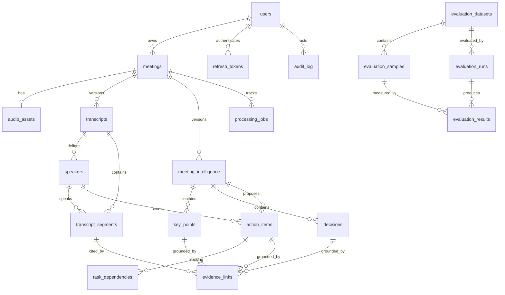

# Data Model

**Version:** 1.0 (Stage 0) · **Target:** PostgreSQL 16 · **Migrations:** Alembic

---

## 1. Design principles

1. **PostgreSQL is the system of record.** Audio lives in object storage; every fact about a meeting lives in the database.
2. **Versions are immutable; pointers move.** Re-running ASR or analysis inserts new rows and flips an `is_active` flag. History is never overwritten, because evaluation and debugging depend on it.
3. **Evidence is relational.** Quotes are rows with offsets and FK constraints — not JSON blobs that cannot be validated.
4. **Unknown is a value, not a missing field.** `owner_speaker_id NULL` plus `owner_resolution='unassigned'` is a deliberate statement; there is no "default owner".
5. **Constraints do the enforcement.** Partial unique indexes, CHECK constraints and FKs prevent invalid states rather than trusting application code.
6. **Enums are `VARCHAR` + `CHECK`, not native `ENUM`.** Native enums require `ALTER TYPE` gymnastics during migrations; a check constraint is altered with one statement. Python mirror types keep application code honest.

Common conventions: UUID v4 primary keys unless noted; `timestamptz` in UTC; `numeric(10,3)` for seconds; `created_at`/`updated_at` server-defaulted; all FKs `ON DELETE CASCADE` unless stated; soft deletes are **not** used (delete is explicit and complete).

## 2. Entity–relationship diagram



`meetings` holds **no** direct FK to its active transcript or intelligence. The relationship is `is_active` + a partial unique index, which avoids a circular FK that would make inserts order-dependent.

## 3. Identity and access

### 3.1 `users`

| Column | Type | Null | Default | Notes |
|---|---|---|---|---|
| `id` | uuid | no | `gen_random_uuid()` | PK |
| `email` | varchar(320) | no | | Stored lowercase; unique |
| `password_hash` | varchar(255) | no | | Argon2id encoded string |
| `display_name` | varchar(120) | no | | 1–120 chars, trimmed |
| `role` | varchar(20) | no | `'user'` | CHECK in (`user`,`admin`) |
| `is_active` | boolean | no | true | Disables login without deleting data |
| `last_login_at` | timestamptz | yes | | |
| `created_at` / `updated_at` | timestamptz | no | `now()` | |

Indexes: `UNIQUE (lower(email))`; `UNIQUE (email)`.
Why both: `email` uniqueness is the invariant; the expression index serves case-insensitive login.

### 3.2 `refresh_tokens`

| Column | Type | Null | Notes |
|---|---|---|---|
| `id` | uuid | no | PK |
| `user_id` | uuid | no | FK users |
| `token_hash` | char(64) | no | SHA-256 hex of the opaque token; the raw token is never stored |
| `family_id` | uuid | no | Rotation family, for reuse detection |
| `expires_at` | timestamptz | no | 7 days |
| `revoked_at` | timestamptz | yes | Set on logout, rotation, or reuse |
| `replaced_by_id` | uuid | yes | FK refresh_tokens (self) |
| `user_agent` | varchar(255) | yes | Truncated |
| `created_at` | timestamptz | no | |

Indexes: `UNIQUE (token_hash)`; `(user_id, expires_at)`; `(family_id)`.
Reuse of a revoked token revokes the whole family and is logged as a security event.

### 3.3 `audit_log`

| Column | Type | Null | Notes |
|---|---|---|---|
| `id` | bigint identity | no | PK |
| `actor_user_id` | uuid | yes | FK users `ON DELETE SET NULL` (system actions are null) |
| `entity_type` | varchar(40) | no | `meeting`, `action_item`, `speaker`, `user` |
| `entity_id` | uuid | no | Not an FK: audit survives deletion by design |
| `action` | varchar(40) | no | `create`, `update`, `delete`, `login`, `export` |
| `changes` | jsonb | yes | `{"field": {"from": ..., "to": ...}}`, values truncated to 500 chars |
| `request_id` | varchar(64) | yes | Correlation |
| `created_at` | timestamptz | no | |

Indexes: `(entity_type, entity_id, created_at DESC)`; `(actor_user_id, created_at DESC)`.

## 4. Meeting core

### 4.1 `meetings`

| Column | Type | Null | Default | Notes |
|---|---|---|---|---|
| `id` | uuid | no | `gen_random_uuid()` | PK |
| `owner_id` | uuid | no | | FK users |
| `title` | varchar(200) | no | | 1–200 chars |
| `description` | text | yes | | ≤ 5,000 chars |
| `meeting_date` | timestamptz | yes | | **Null when not supplied.** Never inferred from upload time |
| `status` | varchar(20) | no | `'created'` | CHECK in (`created`,`processing`,`ready`,`failed`) |
| `intelligence_status` | varchar(20) | no | `'pending'` | CHECK in (`pending`,`processing`,`ready`,`failed`,`skipped`) |
| `language` | varchar(10) | yes | | BCP-47 from ASR |
| `duration_seconds` | numeric(10,3) | yes | | From probe |
| `search_vector` | tsvector | yes | | Generated from title + description + active summary |
| `created_at` / `updated_at` | timestamptz | no | `now()` | |

Indexes:
- `(owner_id, created_at DESC)` — dashboard and list.
- `(owner_id, status)` — filters.
- `GIN (search_vector)`.
- `GIN (title gin_trgm_ops)` — fuzzy title search (`pg_trgm` extension).

The `search_vector` is **not** a stored generated column, because it depends on the active summary in another table. It is updated by the intelligence service and by `PATCH /meetings`; a reconciliation job rebuilds it if drift is detected.

### 4.2 `audio_assets`

| Column | Type | Null | Notes |
|---|---|---|---|
| `id` | uuid | no | PK |
| `owner_id` | uuid | no | Denormalised from meeting for the dedupe index |
| `meeting_id` | uuid | no | FK meetings, `UNIQUE` (one asset per meeting) |
| `storage_backend` | varchar(20) | no | `s3` or `local` |
| `bucket` | varchar(120) | no | |
| `object_key` | varchar(512) | no | `audio/{owner_id}/{meeting_id}/original.{ext}` |
| `normalized_object_key` | varchar(512) | yes | `…/normalized.wav` after ingest |
| `original_filename` | varchar(255) | no | Sanitised, display only |
| `content_type` | varchar(100) | no | Sniffed, not client-provided |
| `codec` | varchar(40) | yes | From ffprobe |
| `container` | varchar(40) | yes | From ffprobe |
| `size_bytes` | bigint | no | CHECK > 0 |
| `sha256` | char(64) | no | Hex digest of original bytes |
| `duration_seconds` | numeric(10,3) | yes | CHECK > 0 |
| `sample_rate` | integer | yes | |
| `channels` | smallint | yes | |
| `probe_raw` | jsonb | yes | Selected ffprobe fields only |
| `purged_at` | timestamptz | yes | Set by retention job |
| `created_at` | timestamptz | no | |

Indexes: `UNIQUE (bucket, object_key)`; `UNIQUE (owner_id, sha256)` — dedupe; `(meeting_id)`; `(purged_at) WHERE purged_at IS NOT NULL`.

Dedupe returns `409 duplicate_audio` with the existing meeting ID rather than creating a second copy. Deleting the meeting removes the unique constraint's row, so re-upload becomes possible.

## 5. Transcript layer

### 5.1 `transcripts`

| Column | Type | Null | Notes |
|---|---|---|---|
| `id` | uuid | no | PK |
| `meeting_id` | uuid | no | FK meetings |
| `version` | integer | no | 1..n per meeting |
| `is_active` | boolean | no | Exactly one true per meeting |
| `status` | varchar(20) | no | (`processing`,`ready`,`failed`) |
| `asr_provider` | varchar(40) | no | `faster_whisper`, `assemblyai`, `deepgram`, `fake` |
| `asr_model` | varchar(120) | no | e.g. `small` |
| `asr_model_revision` | varchar(120) | yes | CTranslate2/HF revision |
| `compute_type` | varchar(20) | yes | `int8`, `float16`, `float32` |
| `diarization_provider` | varchar(40) | yes | null when disabled/failed |
| `diarization_model` | varchar(120) | yes | `speaker-diarization-community-1` |
| `language` | varchar(10) | yes | Detected |
| `language_probability` | numeric(4,3) | yes | 0–1 |
| `audio_duration_seconds` | numeric(10,3) | yes | |
| `processing_seconds` | numeric(10,3) | yes | Wall clock |
| `real_time_factor` | numeric(8,4) | yes | `processing / audio` |
| `segment_count` | integer | yes | |
| `capability_notes` | jsonb | yes | e.g. `{"diarization": "disabled:no_hf_token"}` |
| `error_code` | varchar(64) | yes | |
| `created_at` / `completed_at` | timestamptz | | |

Indexes: `UNIQUE (meeting_id, version)`; `UNIQUE (meeting_id) WHERE is_active`.
CHECK: `real_time_factor IS NULL OR real_time_factor > 0`.

### 5.2 `speakers`

| Column | Type | Null | Notes |
|---|---|---|---|
| `id` | uuid | no | PK |
| `transcript_id` | uuid | no | FK transcripts |
| `label` | varchar(50) | no | Raw diarization label, e.g. `SPEAKER_00` |
| `display_name` | varchar(120) | yes | **User-supplied only.** Never auto-filled from a guessed name |
| `is_named` | boolean | no | `display_name IS NOT NULL` |
| `total_speaking_seconds` | numeric(10,3) | yes | Derived |
| `segment_count` | integer | yes | Derived |
| `created_at` | timestamptz | no | |

Indexes: `UNIQUE (transcript_id, label)`; `(transcript_id, total_speaking_seconds DESC)`.

**Speaker identity is version-scoped.** Speakers belong to one transcript, so activating a new transcript invalidates every `action_items.owner_speaker_id` that points at the old version. The FK is `ON DELETE RESTRICT` precisely so this cannot be silently cascaded. The MVP does not re-transcribe an existing meeting; only analysis re-runs are exposed, and they reuse the active transcript. A future re-transcription path must first remap owners by `display_name`, then downgrade unmatched owners to `owner_resolution = unresolved_mention` with `owner_speaker_id = NULL`, all inside the activation transaction.

### 5.3 `transcript_segments`

| Column | Type | Null | Notes |
|---|---|---|---|
| `id` | bigint identity | no | PK — high volume, cheap ordinal |
| `transcript_id` | uuid | no | FK transcripts |
| `speaker_id` | uuid | yes | FK speakers; null = unattributed |
| `sequence` | integer | no | 0-based order |
| `start_ms` | integer | no | CHECK ≥ 0 |
| `end_ms` | integer | no | CHECK > start_ms |
| `text` | text | no | Preserves ASR punctuation/casing |
| `words` | jsonb | yes | `[{"w":"hello","s":1200,"e":1350}]` compact form |
| `avg_logprob` | numeric(6,4) | yes | ASR confidence proxy |
| `no_speech_prob` | numeric(6,4) | yes | |
| `is_low_confidence` | boolean | no | `avg_logprob < -1.0` **or** speaker overlap < 60% |
| `search_vector` | tsvector | no | Generated: `to_tsvector('english', text)` |

Indexes: `UNIQUE (transcript_id, sequence)`; `(transcript_id, start_ms)`; `GIN (search_vector)`; `(speaker_id) WHERE speaker_id IS NOT NULL`.

Storage estimate: a 1-hour meeting is ~240–720 segments; `words` adds ~250–400 KB of JSON per meeting. Acceptable, and it enables word-precise evidence offsets.

## 6. Intelligence layer

### 6.1 `meeting_intelligence`

| Column | Type | Null | Notes |
|---|---|---|---|
| `id` | uuid | no | PK |
| `meeting_id` | uuid | no | FK meetings |
| `transcript_id` | uuid | no | FK transcripts — the exact transcript analysed |
| `version` | integer | no | 1..n |
| `is_active` | boolean | no | Exactly one true per meeting |
| `status` | varchar(20) | no | (`pending`,`running`,`ready`,`failed`) |
| `llm_provider` | varchar(40) | no | `openai`, `groq`, `fake` |
| `llm_model` | varchar(120) | no | From config, recorded per run |
| `prompt_version` | varchar(40) | no | e.g. `2026-11-02.1` |
| `schema_version` | varchar(20) | no | `1.0.0` |
| `temperature` | numeric(3,2) | yes | |
| `chunk_count` | integer | yes | 1 when single-pass |
| `input_tokens` | integer | yes | |
| `output_tokens` | integer | yes | |
| `cost_usd` | numeric(10,6) | yes | Computed from recorded token counts and a versioned price table |
| `latency_ms` | integer | yes | |
| `attempt_count` | smallint | yes | |
| `quality_metrics` | jsonb | yes | `{"grounding_failures":3,"duplicates_merged":2,"items_dropped":3}` |
| `summary_short` | text | yes | ≤ 80 words, enforced in schema |
| `summary_detailed` | text | yes | |
| `topics` | text[] | yes | ≤ 10 tags; GIN indexed |
| `error_code` | varchar(64) | yes | |
| `created_at` / `completed_at` | timestamptz | | |

Indexes: `UNIQUE (meeting_id, version)`; `UNIQUE (meeting_id) WHERE is_active`; `GIN (topics)`; `(llm_model, prompt_version)` for evaluation grouping.

### 6.2 `key_points`

| Column | Type | Null | Notes |
|---|---|---|---|
| `id` | uuid | no | PK |
| `intelligence_id` | uuid | no | FK meeting_intelligence |
| `sequence` | integer | no | |
| `text` | text | no | One sentence, ≤ 300 chars |
| `created_at` | timestamptz | no | |

Indexes: `UNIQUE (intelligence_id, sequence)`.

### 6.3 `decisions`

| Column | Type | Null | Notes |
|---|---|---|---|
| `id` | uuid | no | PK |
| `intelligence_id` | uuid | no | FK |
| `meeting_id` | uuid | no | Denormalised for scoping |
| `sequence` | integer | no | |
| `text` | text | no | ≤ 500 chars |
| `rationale` | text | yes | Only if stated in the transcript |
| `made_by_speaker_id` | uuid | yes | FK speakers `ON DELETE SET NULL`; null = not attributable |
| `confidence` | numeric(3,2) | yes | 0–1, self-reported, uncalibrated |
| `created_at` | timestamptz | no | |

Indexes: `UNIQUE (intelligence_id, sequence)`; `(meeting_id)`.

### 6.4 `action_items`

| Column | Type | Null | Notes |
|---|---|---|---|
| `id` | uuid | no | PK |
| `meeting_id` | uuid | no | FK meetings |
| `intelligence_id` | uuid | yes | FK; **null = manually created by a user** |
| `sequence` | integer | yes | Order within the run; null for manual items |
| `title` | varchar(300) | no | Imperative, ≤ 300 chars |
| `description` | text | yes | |
| `owner_speaker_id` | uuid | yes | FK speakers `ON DELETE RESTRICT` — protects the CHECK invariant below |
| `owner_text` | varchar(200) | yes | Verbatim assignment phrase, e.g. "Ravi, can you…" |
| `owner_resolution` | varchar(30) | no | CHECK in (`matched_speaker`,`unresolved_mention`,`unassigned`) |
| `due_date` | date | yes | Resolved date only |
| `due_date_text` | varchar(200) | yes | Verbatim phrase, e.g. "end of next sprint" |
| `due_date_precision` | varchar(20) | no | CHECK in (`day`,`week`,`month`,`quarter`,`unknown`) |
| `priority` | varchar(20) | no | CHECK in (`low`,`medium`,`high`,`critical`,`unknown`) |
| `status` | varchar(20) | no | CHECK in (`open`,`in_progress`,`blocked`,`done`,`cancelled`) |
| `confidence` | numeric(3,2) | yes | |
| `is_user_edited` | boolean | no | Set on any PATCH; protects edits from re-analysis |
| `created_at` / `updated_at` | timestamptz | no | |

Constraints:
- `CHECK (owner_resolution <> 'matched_speaker' OR owner_speaker_id IS NOT NULL)`
- `CHECK (owner_resolution = 'unassigned' OR owner_text IS NOT NULL)` — a mention must be quoted
- `CHECK (due_date_precision <> 'unknown' OR due_date IS NULL)`
- `CHECK (due_date IS NULL OR due_date_text IS NOT NULL)`

Indexes: `(meeting_id, status)`; `(owner_speaker_id)`; `(due_date) WHERE status NOT IN ('done','cancelled')`; `GIN (title gin_trgm_ops)`; `(intelligence_id)`.

### 6.5 `task_dependencies`

| Column | Type | Null | Notes |
|---|---|---|---|
| `blocked_id` | uuid | no | FK action_items, the dependent task |
| `blocker_id` | uuid | no | FK action_items, the prerequisite |
| `created_at` | timestamptz | no | |

PK `(blocked_id, blocker_id)`. `CHECK (blocked_id <> blocker_id)`. Cycle detection is enforced in the service layer on write (a self-referential DB check cannot detect longer cycles).

### 6.6 `evidence_links`

| Column | Type | Null | Notes |
|---|---|---|---|
| `id` | uuid | no | PK |
| `meeting_id` | uuid | no | Denormalised, enables scoping and cascade |
| `transcript_segment_id` | bigint | no | FK transcript_segments |
| `decision_id` | uuid | yes | FK decisions |
| `action_item_id` | uuid | yes | FK action_items |
| `key_point_id` | uuid | yes | FK key_points |
| `quote` | text | no | Verbatim substring, ≤ 1,000 chars |
| `char_start` | integer | no | Offset within `transcript_segments.text` |
| `char_end` | integer | no | |
| `verified_at` | timestamptz | no | Server-side verification timestamp |

Constraint: `CHECK (num_nonnulls(decision_id, action_item_id, key_point_id) = 1)`.
Indexes: `(transcript_segment_id)`; `(decision_id)`; `(action_item_id)`; `(key_point_id)`; `(meeting_id)`.

**Polymorphism trade-off:** a single `target_id` column would be simpler but unenforceable. Three nullable FKs plus a CHECK keeps referential integrity at the cost of one wider table. This is the right trade for a project whose central claim is traceability.

## 7. Processing and evaluation

### 7.1 `processing_jobs`

| Column | Type | Null | Notes |
|---|---|---|---|
| `id` | uuid | no | PK |
| `meeting_id` | uuid | no | FK meetings |
| `job_type` | varchar(30) | no | (`ingest`,`transcribe`,`analyze`,`purge`) |
| `status` | varchar(20) | no | (`queued`,`running`,`succeeded`,`failed`,`cancelled`) |
| `stage` | varchar(40) | yes | Human-readable sub-stage |
| `progress` | smallint | no | 0–100 CHECK |
| `attempt` | smallint | no | 0-based |
| `max_attempts` | smallint | no | |
| `idempotency_key` | varchar(80) | no | `sha256(...)` hex; UNIQUE |
| `celery_task_id` | varchar(80) | yes | |
| `input_fingerprint` | varchar(80) | yes | Audio digest or `(transcript, prompt, model)` digest |
| `error_code` | varchar(64) | yes | Typed, user-visible |
| `error_detail` | text | yes | Sanitised; no paths or tokens |
| `metadata` | jsonb | yes | Provider/model/RTF for this attempt |
| `queued_at` | timestamptz | no | |
| `started_at` / `finished_at` | timestamptz | yes | |
| `duration_ms` | integer | yes | |
| `updated_at` | timestamptz | no | |

Indexes: `UNIQUE (idempotency_key)`; `(meeting_id, queued_at DESC)`; `(status, queued_at)` for reconciliation; `UNIQUE (meeting_id, job_type) WHERE status IN ('queued','running')` — prevents concurrent duplicates.

### 7.2 Evaluation tables

**`evaluation_datasets`**: `id`, `name` (`ami-ihm-mini`, `self-recorded-v1`), `version`, `license` (`CC-BY-4.0`), `source_url`, `manifest_sha256`, `sample_count`, `notes`, `created_at`. Unique `(name, version)`.

**`evaluation_samples`**: `id`, `dataset_id`, `sample_ref` (e.g. `ES2002a`), `audio_object_key` (null if not downloadable), `reference_transcript_key`, `reference_rttm_key`, `reference_extraction` jsonb (ground-truth decisions/actions), `duration_seconds`, `condition` (`ihm`,`sdm`,`noisy`), `created_at`. Unique `(dataset_id, sample_ref)`.

**`evaluation_runs`**: `id`, `dataset_id`, `git_commit`, `asr_provider`, `asr_model`, `diarization_model`, `llm_model`, `prompt_version`, `config` jsonb, `status`, `started_at`, `finished_at`, `notes`. Index `(dataset_id, started_at DESC)`.

**`evaluation_results`**: `id`, `run_id`, `sample_id`, `wer`, `cer`, `der`, `extraction_precision`, `extraction_recall`, `extraction_f1`, `owner_accuracy`, `deadline_accuracy`, `decision_f1`, `evidence_grounding_rate`, `invented_owner_count`, `latency_seconds`, `cost_usd`, `metrics` jsonb (raw details), `created_at`. Unique `(run_id, sample_id)`.

Aggregate reporting is computed by SQL over `evaluation_results`, never stored as a hand-typed number.

## 8. State machines

```text
meeting.status:        created ──▶ processing ──▶ ready
                                   │
                                   └──────────▶ failed ──(retry)──▶ processing

intelligence_status:   pending ──▶ processing ──▶ ready
                                    │
                                    ├──────────▶ failed ──(retry)──▶ processing
                                    └──────────▶ skipped   (no LLM configured)

job.status:            queued ──▶ running ──▶ succeeded
                          ▲          │
                          │          ├──▶ failed (terminal after max_attempts)
                          └──────────┘ retry
```

`meeting.status` becomes `ready` only when a **ready transcript** exists. Intelligence failure does not regress a ready transcript; it surfaces as `intelligence_status='failed'`. This distinction is what lets the product remain useful without an LLM.

## 9. Representative queries

**Overdue action items for a user (dashboard):**

```sql
SELECT ai.id, ai.title, ai.due_date, m.title AS meeting_title
FROM action_items ai
JOIN meetings m ON m.id = ai.meeting_id
WHERE m.owner_id = :user_id
  AND ai.status NOT IN ('done','cancelled')
  AND ai.due_date < CURRENT_DATE
ORDER BY ai.due_date ASC
LIMIT 20;
```

**Transcript search with highlighted fragments:**

```sql
SELECT s.id, s.start_ms, s.end_ms, sp.label,
       ts_headline('english', s.text, websearch_to_tsquery('english', :q)) AS snippet,
       ts_rank(s.search_vector, websearch_to_tsquery('english', :q)) AS rank
FROM transcript_segments s
JOIN transcripts t ON t.id = s.transcript_id AND t.is_active
JOIN meetings m ON m.id = t.meeting_id AND m.owner_id = :user_id
LEFT JOIN speakers sp ON sp.id = s.speaker_id
WHERE s.transcript_id = :transcript_id
  AND s.search_vector @@ websearch_to_tsquery('english', :q)
ORDER BY rank DESC, s.start_ms ASC
LIMIT :limit;
```

**Items whose evidence failed verification (quality report):**

```sql
SELECT mi.id, mi.quality_metrics->>'items_dropped' AS dropped
FROM meeting_intelligence mi
WHERE mi.status = 'ready'
  AND (mi.quality_metrics->>'items_dropped')::int > 0
ORDER BY mi.completed_at DESC;
```

**Evidence for one meeting, grouped in a single round trip:**

```sql
SELECT e.action_item_id, e.quote, e.char_start, e.char_end,
       s.id AS segment_id, s.start_ms, s.speaker_id
FROM evidence_links e
JOIN transcript_segments s ON s.id = e.transcript_segment_id
WHERE e.meeting_id = :meeting_id AND e.action_item_id IS NOT NULL
ORDER BY s.start_ms;
```

## 10. Deletion and retention

| Action | Effect |
|---|---|
| `DELETE /meetings/{id}` | Object keys are captured first; rows are deleted in dependency order (evidence → items → decisions → key points → intelligence → segments → speakers → transcripts → asset → jobs → meeting); after the commit, the captured objects are deleted. A failed object delete is logged for the orphan sweep. |
| Retention job | **Deferred.** `audio_assets.purged_at` exists and is surfaced in the API, but no scheduled retention purge is implemented. Audio lives until the meeting is deleted. |
| User deletion | Not exposed in v1; documented as an admin/SQL procedure to avoid a half-built feature. |

Order of operations on delete: capture object keys → delete rows in dependency order → commit → delete objects. There is no `deleted` meeting state: a half-deleted meeting must never be observable. The purge cannot be a row in `processing_jobs` after the delete, because jobs cascade with the meeting; that is why the MVP deletes objects directly after commit and defers the durable purge queue.

## 11. Migration policy

- One Alembic revision per stage (or per logical change), never edited after being applied to `main`.
- `alembic upgrade head` runs during deployment; the API refuses to start if the schema revision is behind (`alembic_version` check at startup).
- No `Base.metadata.create_all()` in production paths. Tests run migrations from an empty database, so migration drift is caught.
- Every migration has a working `downgrade()`. Data migrations are separate revisions from DDL.
- Adding an enum value = drop and recreate the CHECK constraint in one transaction.
- Required extensions: `pgcrypto` (gen_random_uuid), `pg_trgm`.

## 12. Capacity estimates

| Data | Per meeting (30 min) | Per 1,000 meetings |
|---|---|---|
| Transcript segments | ~150–360 rows | ~250k rows, ~150 MB |
| `words` JSONB | ~150 KB | ~150 MB |
| Evidence links | ~10–40 rows | ~25k rows |
| Audio (original + normalised) | ~40 MB | ~40 GB (before retention) |

Indexes remain small; the dominant storage cost is audio, which retention addresses. No partitioning in v1; the design notes partition-by-meeting as the next step past ~10⁷ segments.
